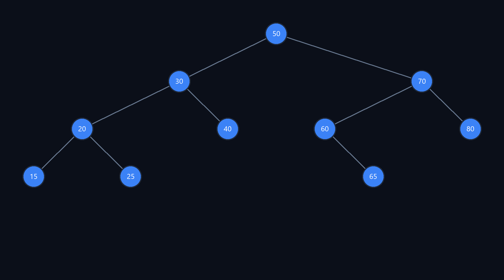
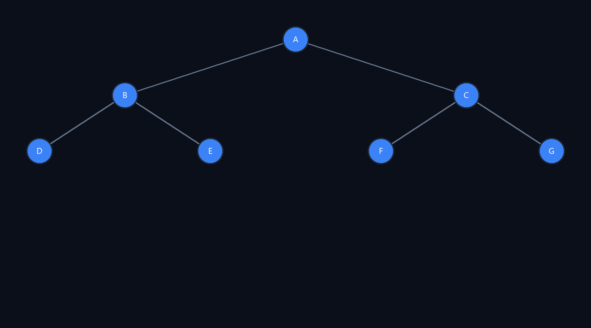
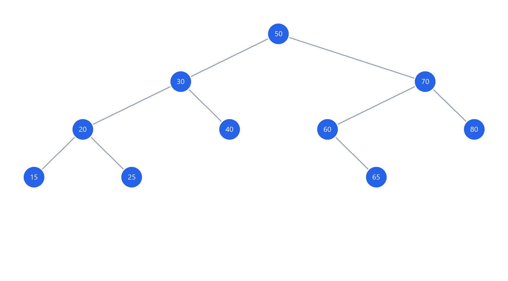
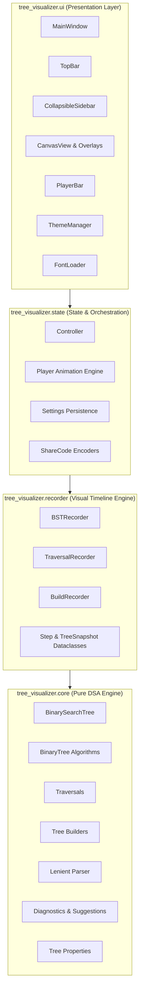

# Tree_Visualizer

[](https://github.com/avipratap-in/Tree_Visualizer/actions/workflows/ci.yml)
[](https://github.com/avipratap-in/Tree_Visualizer/releases/latest)
[](https://opensource.org/licenses/MIT)
[](https://www.python.org/downloads/)

An interactive, high-performance desktop application for exploring, visualizing, animating, and reconstructing **Binary Trees** and **Binary Search Trees (BSTs)** in Python. Built from the ground up for academic rigor, pedagogical clarity, and professional visual polish.

---

## Screenshots

<div align="center">
  
  
  <p><em>Binary Search Tree and Inorder+Postorder Reconstruction Views</em></p>
</div>

<div align="center">
  
  <p><em>Light Theme Palette with High-Contrast Mathematical Rendering</em></p>
</div>

<!-- Full application desktop window screenshots: -->
<!-- TODO: Full-window UI screenshot (Dark Mode with Operations Sidebar and Player Bar) -->
<!-- TODO: Full-window UI screenshot (Reconstruction Tab with Live Validation Hints) -->

---

## Features

- **Three Dedicated Operating Modes**:
  - **Binary Search Tree (BST)**: Search, Insert, Remove (handling leaves, 1-child bypass, and 2-children successor replacement), Min, Max, Inorder Predecessor & Successor, and Order-Statistic Rank & Select. Includes classic preset trees (Degenerate Left/Right, Balanced, Zig-Zag, Micro 3-Node).
  - **Binary Tree**: Random tree generation (numeric 1–99 or alphabetic A–Z), lenient sequence loading, 4 traversal visualizers (Preorder, Inorder, Postorder, Level-Order), and live real-time Tree Properties (Nodes, Height, Leaves, Min Depth, Diameter, Balance Factor, AVL Balance status).
  - **Tree Reconstruction**: 6 reconstruction modes (Preorder+Inorder, Inorder+Postorder, Level-Order+Inorder, Preorder+Postorder for Full Trees, BST from Preorder, BST from Postorder) with live debounced diagnostics, intelligent 1-click auto-fix suggestions, and ambiguity warnings.
- **Pedagogical Step-by-Step Animation**:
  - Deterministic timeline recording producing snapshots with node/edge highlights, visited node sequences, contextual narrative status messages, and synchronized pseudocode line execution.
  - Media player bar with Play, Pause, Replay, Step Forward, Step Backward, draggable progress scrubber, and speed multipliers (0.5x, 1x, 1.5x, 2x, 4x).
- **Mathematical Layout & High-DPI Canvas**:
  - Inorder X-coordinate projection guaranteeing zero edge crossings.
  - Windows DPI awareness (`SetProcessDpiAwareness`) rendering razor-sharp vector text and antialiased nodes.
  - Interactive smooth mouse wheel zoom toward cursor, drag-to-pan, 100% reset, and tweening animations between algorithm steps.
- **Multi-Format Export & Sharing**:
  - **JSON**: Clean structural serialization.
  - **PNG**: High-resolution 2x retina Pillow image rendering independent of Ghostscript.
  - **SVG**: Pure Python vector graphics export using the standard library.
  - **Share Codes**: URL-safe Base64 encoded JSON representations with 1-click clipboard copy and import dialog.
- **Theme Engine**:
  - Modern Clam-based Dark Mode (Slate / Navy) and Light Mode (Clean Academic) with instant live switching.
  - Custom font loading: Elegant cursive **Rouge Script** for empty-state definition cards (via Windows GDI `AddFontResourceExW` and `tkextrafont`), Segoe UI for crisp system typography, and Consolas for pseudocode.

---

## Download

Pre-compiled standalone Windows executables with bundled assets and fonts are available on GitHub Releases:

👉 **[Download Latest Release (`Tree_Visualizer.exe`)](https://github.com/avipratap-in/Tree_Visualizer/releases/latest)**

Simply download `Tree_Visualizer.exe` and double-click to launch—no Python installation required.

---

## Running from Source

### Prerequisites
- **Python 3.11** or newer (Python 3.11, 3.12, 3.13, 3.14).
- **Linux Users**: Tkinter must be installed via your system package manager:
  ```bash
  sudo apt-get update && sudo apt-get install -y python3-tk
  ```

### Installation
1. Clone the repository:
   ```bash
   git clone https://github.com/avipratap-in/Tree_Visualizer.git
   cd Tree_Visualizer
   ```

2. Create and activate a virtual environment:
   ```bash
   python -m venv .venv
   # Windows (PowerShell):
   .venv\Scripts\Activate.ps1
   # Linux/macOS:
   source .venv/bin/activate
   ```

3. Install dependencies:
   ```bash
   pip install -r requirements.txt
   pip install -r requirements-dev.txt
   ```

4. Launch the application:
   ```bash
   python -m tree_visualizer
   ```

---

## Running Tests

The test suite contains **180+ automated unit, property, and GUI tests** covering pure DSA algorithms, recorders, state transitions, lenient parsing, and Tkinter UI components.

```bash
# Run full test suite:
pytest -v

# Run on Linux headlessly (under xvfb):
xvfb-run -a pytest -v
```

---

## Building the Standalone Executable

To package `Tree_Visualizer` into a single standalone Windows executable (`Tree_Visualizer.exe`) with the custom application icon and bundled font assets:

```bash
python scripts/build_exe.py
```

The resulting executable will be generated at `dist/Tree_Visualizer.exe`.

---

## Architecture Diagram

The codebase strictly enforces a clean unidirectional layered architecture. Tkinter and GUI frameworks are never imported inside the core, recorder, or state modules.



---

## Algorithm Complexity Table

| Category | Operation / Algorithm | Average Time | Worst Time | Auxiliary Space | Description / Notes |
|---|---|---|---|---|---|
| **BST** | Search($v$) | $O(\log n)$ | $O(n)$ | $O(h)$ | Compares key; traverses left or right branch |
| **BST** | Insert($v$) | $O(\log n)$ | $O(n)$ | $O(h)$ | Inserts new leaf or increments frequency counter |
| **BST** | Remove($v$) | $O(\log n)$ | $O(n)$ | $O(h)$ | Leaf prune, 1-child bypass, or 2-children successor swap |
| **BST** | Min / Max | $O(\log n)$ | $O(n)$ | $O(h)$ | Follows leftmost or rightmost pointer chain |
| **BST** | Predecessor / Successor | $O(\log n)$ | $O(n)$ | $O(h)$ | Inorder adjacent value in sorted key sequence |
| **BST** | Rank($v$) (1-based) | $O(\log n)$ | $O(n)$ | $O(h)$ | Computes count of keys strictly smaller than $v + 1$ |
| **BST** | Select($k$) | $O(\log n)$ | $O(n)$ | $O(h)$ | Finds the $k$-th smallest key in the BST |
| **Traversal** | Preorder | $O(n)$ | $O(n)$ | $O(h)$ | Root $\rightarrow$ Left $\rightarrow$ Right (DFS) |
| **Traversal** | Inorder | $O(n)$ | $O(n)$ | $O(h)$ | Left $\rightarrow$ Root $\rightarrow$ Right (yields sorted order in BST) |
| **Traversal** | Postorder | $O(n)$ | $O(n)$ | $O(h)$ | Left $\rightarrow$ Right $\rightarrow$ Root (bottom-up DFS) |
| **Traversal** | Level-Order (BFS) | $O(n)$ | $O(n)$ | $O(w)$ | Breadth-first level-by-level queue traversal ($w \le n/2$) |
| **Properties** | Height & Depth | $O(n)$ | $O(n)$ | $O(h)$ | $1 + \max(h_L, h_R)$ calculated recursively |
| **Properties** | Tree Diameter | $O(n)$ | $O(n)$ | $O(h)$ | Longest simple path between any pair of nodes |
| **Properties** | AVL Balance Check | $O(n)$ | $O(n)$ | $O(h)$ | Verifies $|h_L - h_R| \le 1$ recursively for every node |
| **Reconstruction** | Preorder + Inorder | $O(n)$ | $O(n)$ | $O(n)$ | Root from `preorder[0]`, partitions `inorder` via hash map |
| **Reconstruction** | Inorder + Postorder | $O(n)$ | $O(n)$ | $O(n)$ | Root from `postorder[-1]`, partitions `inorder` |
| **Reconstruction** | Level-Order + Inorder | $O(n^2)$ | $O(n^2)$ | $O(n)$ | Root from level-order, filters partitions by set membership |
| **Reconstruction** | Preorder + Postorder | $O(n)$ | $O(n)$ | $O(n)$ | Guaranteed unique for Full Binary Trees; flags ambiguity |
| **Reconstruction** | BST from Preorder | $O(n)$ | $O(n)$ | $O(n)$ | Reconstructs BST with value range bounding $(-\infty, +\infty)$ |
| **Reconstruction** | BST from Postorder | $O(n)$ | $O(n)$ | $O(n)$ | Reverse-scan postorder with value range bounding |

*For in-depth explanations and capstone report references, consult [docs/ALGORITHMS.md](docs/ALGORITHMS.md).*

---

## Credits & Acknowledgments

- **Inspiration**: Concept and visual pedagogy inspired by the pioneering work of [VisuAlgo](https://visualgo.net/) (Steven Halim et al., National University of Singapore).
- **Typography**: [Rouge Script](https://fonts.google.com/specimen/Rouge+Script) designed by Brenda Gallo, licensed under the [SIL Open Font License, Version 1.1](http://scripts.sil.org/OFL).
- **Original Web Edition**: The original web-based edition of this project remains accessible at [https://avipratap-in.github.io/binary-tree-bst-visualizer/](https://avipratap-in.github.io/binary-tree-bst-visualizer/) (source repository: [https://github.com/avipratap-in/binary-tree-bst-visualizer](https://github.com/avipratap-in/binary-tree-bst-visualizer)).

---

## License

This project is licensed under the [MIT License](LICENSE).
